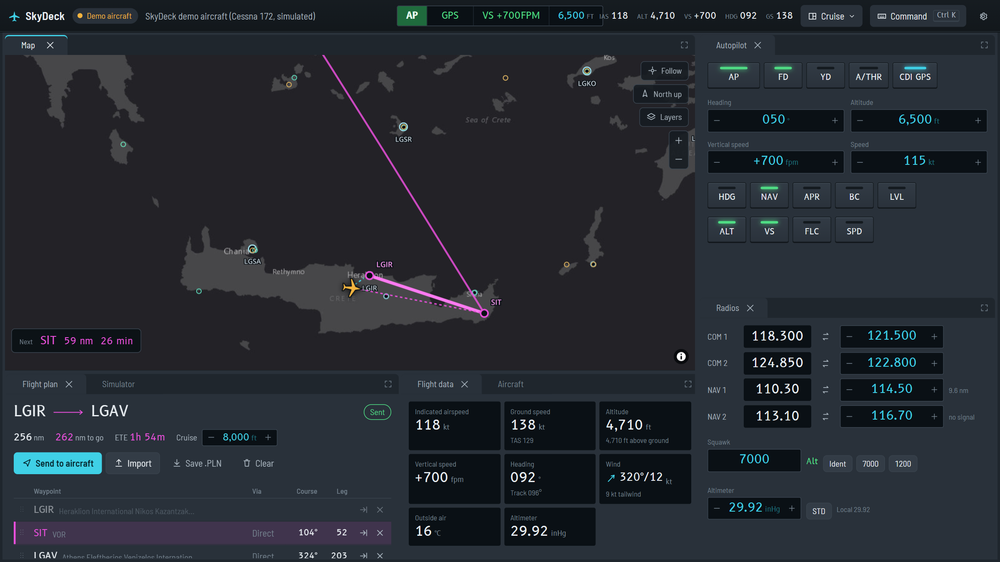

<h1 align="center">SkyDeck</h1>

<p align="center">
  <strong>A control centre for Microsoft Flight Simulator 2020.</strong><br>
  Moving map, flight planning, autopilot, radios and sim controls on your second monitor, tablet or laptop.
</p>

<p align="center">
  
</p>

SkyDeck runs on your PC next to MSFS and serves a dashboard you open in any browser. You can rearrange the
panels into the layout you like. Everything stays in sync both ways: change the heading bug in the cockpit and
SkyDeck shows it, set it in SkyDeck and the aircraft follows.

It is a single `.exe` with no installer and no account. You don't need any MSFS add-on except for the optional
in-flight flight plan link described below.

## Features

- **Moving map**: live aircraft, the track you've flown, the flight plan with SIDs, STARs and approaches, airports
  and navaids, and a heading-bug line. Right-click for *Direct to*, *Add to flight plan* or *Move aircraft here*.
  Click an airport for its frequencies and runways.
- **Flight planning**: search airports, navaids and fixes, then drag waypoints to reorder them. Runways and
  procedures come from the sim's own navigation database. There's also a vertical profile. Import from SimBrief,
  the MSFS World Map, `.PLN` files or a typed route, then **Send to MSFS**, before or during the flight.
- **Aircraft controls**: autopilot, COM/NAV radios, transponder, altimeter, lights, flaps, gear, engines and fuel.
- **Text ATC**: from clearance delivery to your parking stand. Pick what to say from a short list of calls and
  controllers answer, handing you on through Ground, Tower, Departure, Control, Approach and back. Frequencies
  come from the airport data, and SkyDeck tells you if you taxi, take off or enter a runway without a clearance.
- **Ground and parking**: taxi routes along the scenery's own taxiways (read from MSFS), drawn on the map with
  turn-by-turn steps, runway crossings and hold-short points. Pick a stand, taxi to it, or move the aircraft
  onto it, with docking guidance for the last few metres.
- **Simulator controls**: pause, sim rate, time of day, slew and pushback. You can also reposition the aircraft to
  a runway or onto an N-mile final.
- **Command bar** (<kbd>Ctrl</kbd>+<kbd>K</kbd>): `alt 8000`, `hdg 270`, `com1 121.5`, `squawk 7000`,
  `direct LGAV`, `final LGIR 27`, `route LGIR SIT LGAV`, `rate 4`, `time 18:30`…
- **Any device on your network**: open SkyDeck on a tablet or a second PC as well as on the PC you're playing on.
- **Demo aircraft**: try everything without the sim running.

## Getting started

**Requirements:** Windows 10/11 and Microsoft Flight Simulator 2020 (Steam or Microsoft Store).

1. Download `SkyDeck.zip` from the latest release and unzip it anywhere.
2. Run `SkyDeck.exe`. The exe is not code-signed, so Windows SmartScreen asks once. Click
   **More info → Run anyway**.
3. SkyDeck opens in your browser at <http://localhost:4500>. Start MSFS and load a flight, and SkyDeck connects
   on its own.

No sim handy? Press **Try the demo aircraft** in the banner.

The full user guide is in [docs/README.txt](docs/README.txt), which is also included in the release zip. It covers
tablets on your network, flight plans with glass cockpits and where settings are stored.

### Flight plans and glass cockpits

Aircraft with modern avionics (G1000 NXi, G3000, airliners) keep their own flight plan. They only read the sim's
plan when a flight starts. So the reliable approach is to build the plan in SkyDeck while MSFS is on the World Map
or main menu, press **Send to aircraft**, then start the flight.

To change the plan *during* a flight, SkyDeck has an optional add-on called **SkyDeck Link**
(`addon/skydeck-link`). You install it from **Settings → SkyDeck Link** and it lets SkyDeck edit the G1000 NXi's
own flight plan. It is **experimental**

## How it works

```
MSFS ──SimConnect──▶ SkyDeck server (Node.js) ──WebSocket/HTTP──▶ browser UI (React)
                      │  telemetry ~15 Hz, commands, facilities (airports, procedures)
                      └─ OurAirports offline data (search, map, frequencies)
```

| Path | What's there |
| --- | --- |
| `src/server/ground`, `src/server/atc` | Taxiway graph and routing (from the sim's facility data), live taxi guidance, and the text ATC engine. |
| `src/server` | Express + WebSocket server. `bridge/simconnect.ts` talks to MSFS through [node-simconnect](https://github.com/EvenAR/node-simconnect) (pure JS, no native build). `bridge/demo.ts` is the simulated aircraft. `flightplan/` reads and writes `.PLN` files and expands procedures. `link/` installs SkyDeck Link. |
| `src/web` | React UI. Panels are in `src/web/panels`. The dock layout uses [dockview](https://dockview.dev) and the map uses [MapLibre](https://maplibre.org) with Esri raster tiles, so no API key is needed. |
| `src/shared` | Types and geo helpers used by both sides. |
| `addon/skydeck-link` | The script SkyDeck Link injects into the G1000 NXi MFD. |
| `scripts` | Navigation data download, build and packaging, plus sim diagnostics. |
| `tests` | Unit tests (Vitest). |

Settings, layouts and the current flight plan are stored in `%APPDATA%\SkyDeck`. The log is at
`%APPDATA%\SkyDeck\skydeck.log`.

## Development

You need [Node.js 22](https://nodejs.org/).

```sh
npm install
npm run navdata      # download OurAirports data into data/generated (once)
npm run dev          # server on :4500 + Vite UI on http://localhost:5173
npm test             # unit tests
npm run typecheck
```

`npm run dev` connects to MSFS if it's running. To ignore the sim and work with the demo aircraft, set
`SKYDECK_NO_SIM=1`.

### Building a release

```sh
npm run package      # → release/SkyDeck/SkyDeck.exe and release/SkyDeck.zip
```

This bundles the server with esbuild and turns it into a Node.js
[single executable application](https://nodejs.org/api/single-executable-applications.html). The web UI and
navigation data sit next to the exe.

Command-line flag: `--no-browser` stops SkyDeck from opening a browser on start.

### Diagnostics

These need MSFS running. Some also need a flight loaded.

```sh
npx tsx scripts/diagnostics/probe-sim.ts LGIR     # connection + an airport's procedures
npx tsx scripts/diagnostics/live-check.ts         # dump live telemetry (needs a flight)
npx tsx scripts/diagnostics/probe-legs.ts LTBA    # SID legs as the sim reports them
npx tsx scripts/diagnostics/probe-fix.ts ASTON LZ # look up a fix (region required)
```

### Notes from testing against MSFS 2020

- The **G1000 NXi** treats `AP_ALT_VAR_SET_ENGLISH` as a single knob step. SkyDeck checks the result and writes
  `AUTOPILOT ALTITUDE LOCK VAR:1` directly when it needs to. The NXi also leaves the legacy
  `GPS WP DISTANCE/ETE` at zero, so SkyDeck works those out from the next waypoint's position.
- Fix look-ups need the ICAO region: `ASTON` alone fails, while `ASTON` + `LZ` works. SkyDeck guesses the region
  from nearby airports.
- In the main menu the user aircraft sits at 0°N 0°E. That's how SkyDeck tells "connected" apart from "in a
  flight".

## Contributing

Bug reports and pull requests are welcome. When you report a sim-related problem, please include:

- your aircraft
- whether you use the Steam or Microsoft Store version of MSFS
- the relevant lines from `%APPDATA%\SkyDeck\skydeck.log`

Before opening a PR, run `npm test` and `npm run typecheck`.

Adding support for another avionics suite (G3000, WT GNS 430/530, WT21…) is a good place to help. Each one needs
its own SkyDeck Link adapter.

By submitting a pull request, you agree that your contribution is licensed under the same terms as the project
(see [License](#license)).

## License

SkyDeck is free for any noncommercial use under the [PolyForm Noncommercial License 1.0.0](LICENSE.md). You can
fly with it, change it, and share your changes. You may not sell it, sell your changed version, or bundle it into a
paid product.

If you want to use SkyDeck commercially, open an issue to ask.

## Credits

- Airport and navaid data: [OurAirports](https://ourairports.com/data/) (public domain)
- Map tiles: Esri, HERE, Garmin, OpenStreetMap contributors
- Fonts: [B612](https://github.com/polarsys/b612) (Airbus, SIL OFL) and Barlow Semi Condensed (SIL OFL)
- Simulator connection: [node-simconnect](https://github.com/EvenAR/node-simconnect) (LGPL-3.0)

SkyDeck is an independent hobby project. It is not affiliated with or endorsed by Microsoft, Asobo Studio or
Working Title. Do not use it for real-world navigation.
